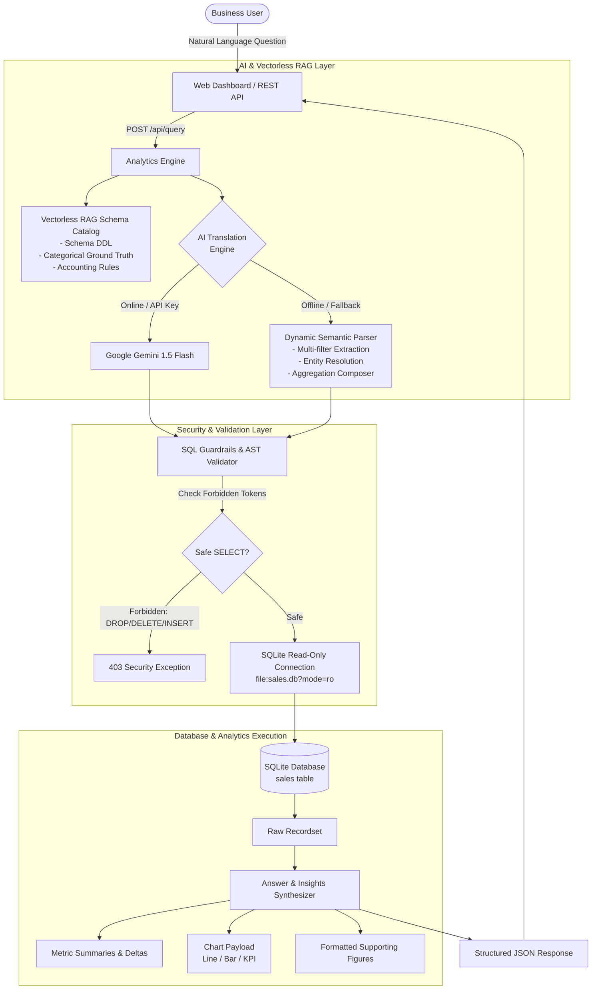

# SalesAgent IQ — System Architecture & Technical Specifications

## 1. High-Level Architecture Overview

The Mini AI Business Intelligence Assistant connects natural language questions to deterministic relational database queries using a **Vectorless RAG** architecture with strict security guardrails.

---

## 2. Component Breakdown

### A. Data Layer (`src/database/`)
- **`schema.sql`**: Relational definition with strict types, non-null constraints, check constraints (`quantity >= 0`, `discount_amount >= 0`), and indexes on `order_date`, `year_month`, `product`, `region`, and `status`.
- **`etl.py`**: Automated pipeline that cleanses raw CSV data:
  - Standardizes dates from European `DD-MM-YYYY` to ISO `YYYY-MM-DD`.
  - Imputes missing `unit_price` in TXN0051 using median product prices.
  - Generates `gross_revenue` (`quantity * unit_price`) and `net_revenue` (`gross_revenue - discount_amount`).
  - Flags and preserves returned transactions (`status = 'Returned'`).
  - Exports a reproducible audit trail to `data/data_cleaning_report.json`.
- **`connection.py`**: Connection pool factory offering:
  - `get_rw_connection()`: Used exclusively during initialization and ETL.
  - `get_ro_connection()`: Strictly read-only connection via SQLite URI `file:sales.db?mode=ro`.

### B. Vectorless RAG & AI Layer (`src/ai/`)
- **`vectorless_rag.py`**: Maintains metadata catalogs, business rule ontologies, and exact distinct values for categories, products, regions, channels, and statuses.
- **`sql_guardrails.py`**: Tokenizes incoming queries using regex word boundaries to prevent token evasion. Rejects destructive statements (`DROP`, `DELETE`, `UPDATE`, `INSERT`, `ALTER`, `TRUNCATE`, `EXEC`), prohibits semicolon-chained multi-statements, and restricts table access to `sales`.
- **`query_parser.py`**: Robust AST and semantic query synthesizer capable of handling multi-dimensional filtering, metric resolution, chronological trend ordering, and comparative variances.
- **`llm_service.py`**: Integrates Google Gemini (`gemini-1.5-flash`) when credentials exist, with auto-fallback to the heuristic parser.

### C. Analytics Engine (`src/analytics/engine.py`)
- Runs validated queries against SQLite.
- Computes period-over-period and dimension-over-dimension variances (absolute change and percentage change).
- Synthesizes clear, executive-grade natural language explanations.
- Generates chart payloads for bar, line, and KPI cards.

### D. REST API & UI (`src/api/` & `src/ui/`)
- **`app.py` & `routes.py`**: Starlette ASGI application providing `/api/query`, `/api/schema`, `/api/summary`, and `/api/health`.
- **`static/`**: High-DPI single-page dashboard with zero external front-end dependencies.
- **`streamlit_app.py`**: Alternative Streamlit interactive dashboard.
